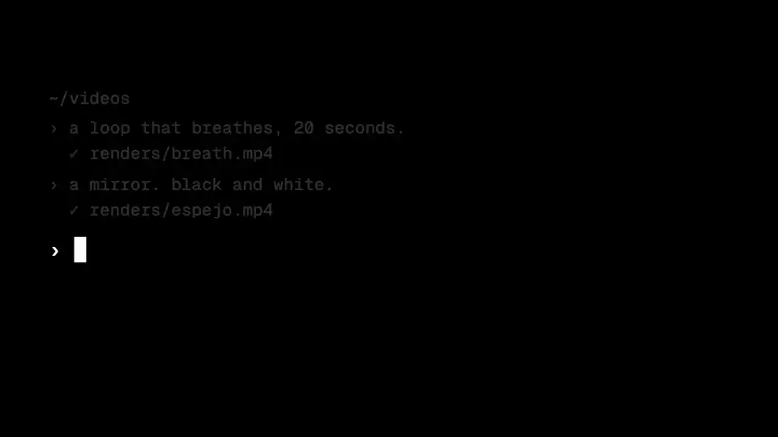
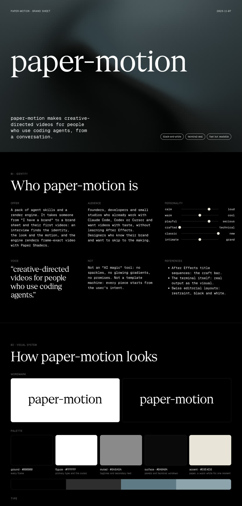
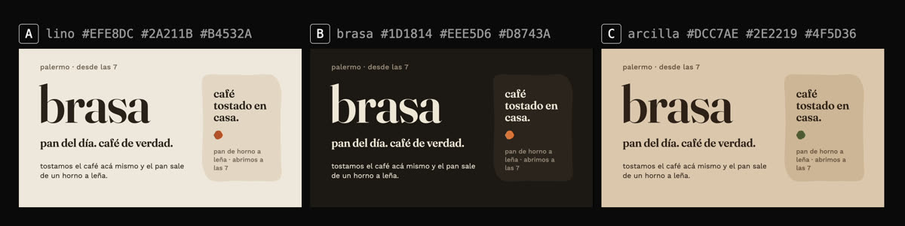

# paper-motion

**Creative-directed videos for people who use coding agents.**

<p></p>

A pack of agent skills that takes you from "I have a brand" to a brand sheet and your first videos, from a
conversation with Claude Code, Codex, Cursor or any agent that reads skills. It finds out who your brand is, how it
looks, moves and sounds, and then makes videos that stay on brand, rendered frame-exact with
[Paper Shaders](https://shaders.paper.design).

If you already know your brand, bring it (fonts, colors, a brand manual, a website, a Figma or Paper file) and skip to
the parts you need.

<p></p>

## How it works

The pack asks before it makes. Every step is an interview in rounds: numbered questions, each with a recommended
answer you can accept with a "yes", and for anything you judge with your eyes or ears, **option boards** (stills,
short clips, or sounds played in turn) you answer with a letter.

<p></p>

Every decision lands in one place, your project's `brand/` folder, so each step builds on the last and your videos
stay consistent from one to the next.

| Step | Skill | What it settles |
|---|---|---|
| 1 | `identity` | Who the brand is: offer, audience, personality, voice, facts, references |
| 2 | `visual-system` | Typefaces, palette, shape language, wordmark |
| 3 | `brand-sheet` | The whole brand on one live page, plus PNG and PDF |
| 4 | `motion-style` | Pace, camera, how text appears, a repertoire of transitions, endings |
| 5 | `sound-kit` | Sound palette, typing sounds, music stance, loudness |
| 6 | `shader-set` | The brand's moving material: fields, patterns, logo effects, image filters |
| 7 | `make-video` | One video, from brief to final render, in 16:9, 9:16 or 1:1 |

Start with `/paper-motion`: it reads your brand folder and tells you where you are and what comes next. Or just ask
for what you want ("help me define my brand", "make a launch video") and the right skill picks it up.

## Install

Requirements: Node ≥ 18, ffmpeg, Google Chrome (or `npx playwright-core install chromium`).

Any agent (Claude Code, Codex, Cursor, Gemini CLI, OpenCode…):

```bash
npx skills add solanodz/paper-motion
```

Claude Code, as a plugin:

```
/plugin marketplace add solanodz/paper-motion
/plugin install paper-motion@paper-motion
```

The skills call the render engine, the npm package [`paper-motion`](packages/engine), through `npx paper-motion`:
nothing else to install. To check your machine first, run `npx paper-motion setup`.

From a clone of this repository:

```bash
git clone https://github.com/solanodz/paper-motion
for d in paper-motion/skills/*/; do ln -s "$PWD/$d" ~/.claude/skills/; done
node paper-motion/packages/engine/bin/pamo.mjs setup
```

Optional: connect the [Paper Desktop](https://paper.design) MCP to tune shaders by hand on the canvas and use it for
style frames. Recommended, never required; the free plan allows 100 calls a week.

## The engine

`packages/engine` renders an HTML scene, a pure function of time, frame by frame in headless Chrome and encodes it
with ffmpeg: MP4, 10-bit HEVC, ProRes, WebM, GIF. Same input, same pixels.

```bash
pamo new launch --dir brand/pieces --format 9:16 --piece   # a scene wired to your brand
pamo preview brand/pieces/launch/scene.html                # live, scrub with ←/→
pamo render brand/pieces/launch/scene.html --motion-blur 8 --loudness -14
pamo status                                                # what your brand folder has
pamo                                                       # every command
```

All 30 Paper Shaders, a library of moves (wipes, pushes, mask reveals, dives into a frame, terminal typing),
synthesized sound effects or real keystrokes split from your own recording, option boards, wordmarks and the brand
sheet.

## Repository

```
skills/                 the pack: paper-motion (entry), interview, identity, visual-system, brand-sheet,
                        motion-style, sound-kit, shader-set, make-video
packages/engine/        the `paper-motion` npm package: CLI, runtime, renderer, templates, examples
examples/paper-motion-brand/   paper-motion's own brand folder, built with the pack
docs/                   spec-v1.md, ADRs
GLOSSARY.md             the shared language every skill uses
```

## Credits

- The interview mechanics follow Matt Pocock's [`grilling`](https://github.com/mattpocock/skills) skill: a design
  tree worked in rounds, with a recommended answer for every question.
- Rendering material: [Paper Shaders](https://shaders.paper.design), Apache-2.0, © Paper. "Powered by Paper Shaders."
- Default keystrokes: [Keyboard Soundpack #1](https://opengameart.org/content/keyboard-soundpack-1-typing-and-single-keystrokes)
  by unicaegames, CC0. They ship inside the npm package only; your own recording replaces them (`pamo keys`).

## License

MIT for the skills and the engine. Paper Shaders: Apache-2.0.

---

### En español

**paper-motion** es un paquete de skills para agentes (Claude Code, Codex, Cursor…) que te lleva de "tengo una
marca" a tu página de identidad y tus primeros videos, conversando. Define quién es tu marca, cómo se ve, cómo se
mueve y cómo suena, con preguntas en rondas y tableros de opciones que elegís con una letra, y después hace videos
que respetan esa marca, renderizados cuadro a cuadro con Paper Shaders. Si ya tenés tu marca definida, la traés y
saltás a lo que necesites. Empezá con `/paper-motion`.
