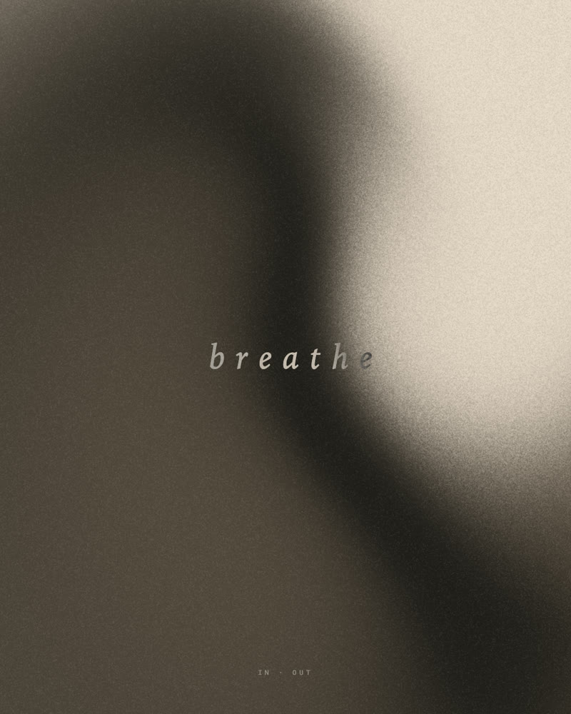
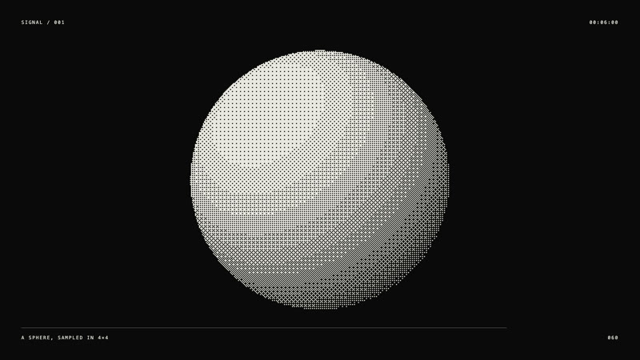
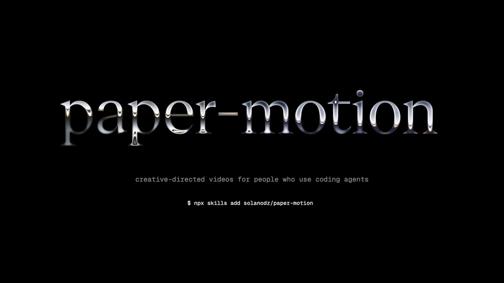

# paper-motion

An agent skill for making **minimal, creative-directed videos** — loops, animated
posters, ambient pieces, title cards — with [Paper Shaders](https://shaders.paper.design)
and your coding agent (Claude Code, Codex, Cursor, …).

There is no built-in style. You describe a feeling; the agent proposes a few
directions as stills, you pick and steer, and it renders a frame-exact video.

<p>
  
  
  
</p>

## How it works

- A piece is one HTML **scene**: a pure function of time `t`.
- **Paper Shaders** (all 30: mesh gradients, grain, dithering, halftone, waves,
  fluted glass, paper texture…) provide the material; HTML/SVG/CSS provide type
  and geometry.
- The engine seeks every frame in headless Chrome and encodes with ffmpeg →
  MP4, 10-bit HEVC, ProRes, WebM, GIF or PNG sequence. Same input, same pixels.
- The agent works like a small studio: brief → 2–3 directions as contact
  sheets → iterate with stills and live preview → final render. It critiques its
  own frames (composition, legibility, banding) before showing you.
- Optional: connect the [Paper Desktop](https://paper.design) MCP to use the
  canvas as a shared sketchbook (layouts, type, hand-tuned shaders).

## Install

Requirements: Node ≥ 18, ffmpeg, Google Chrome (or `npx playwright-core install chromium`).

**Claude Code** — copy or symlink the skill folder:
```bash
git clone <this-repo> paper-motion
for d in paper-motion/skills/*/; do ln -s "$PWD/$d" ~/.claude/skills/; done
node paper-motion/packages/engine/bin/pm.mjs setup
```

**Any agent with skills support** (Codex, Cursor, Gemini CLI, OpenCode…) — put
the folders in `skills/` in that agent's skills folder, or use the cross-agent
installer: `npx skills add <owner>/<repo>`.

**Any agent at all** — open this repo (or copy `skills/` into your
project) and keep `AGENTS.md`; it tells the agent to read the skill.

## Use

Just ask:

> make a 12 second 4:5 loop that feels like breathing, warm and grainy
>
> turn this photo into a dithered, slowly drifting piece for my site hero
>
> a square, Swiss-print style animated poster for "Tide Tables No. 3"

Or drive the CLI yourself:

```bash
node packages/engine/bin/pm.mjs new my-piece --size 1080x1350 --duration 12
node packages/engine/bin/pm.mjs preview works/my-piece/scene.html
node packages/engine/bin/pm.mjs still   works/my-piece/scene.html --count 6
node packages/engine/bin/pm.mjs render  works/my-piece/scene.html --format hevc
node packages/engine/bin/pm.mjs shaders
```

## Layout

```
skills/make-video/
  SKILL.md              the workflow the agent follows
  references/           craft guide, scene API, shader catalog, rendering, Paper canvas
packages/engine/        @paper-motion/engine: CLI, runtime, preview server, renderer
  examples/             breath · signal · install-loop · chrome-endcard
```

---

### En español

**paper-motion** es una skill para agentes (Claude Code, Codex, Cursor…) que
genera videos minimalistas con calidad de obra, usando Paper Shaders. No impone
un estilo: describís lo que querés sentir, el agente propone 2–3 direcciones
como fotogramas, vos elegís y ajustás, y renderiza un video exacto cuadro a
cuadro (MP4, HEVC 10-bit, ProRes, WebM, GIF). Opcionalmente usa el MCP de
Paper Desktop como lienzo compartido. Instalación y uso: ver arriba.

## License

The skill and engine: MIT. Paper Shaders: Apache-2.0, © Paper —
"Powered by Paper Shaders" (https://shaders.paper.design).
